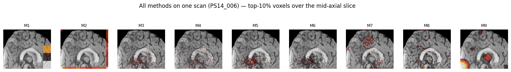
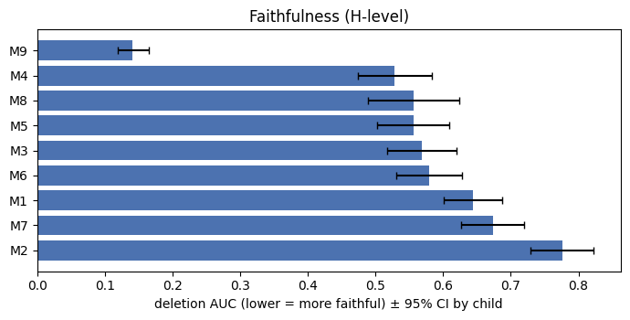
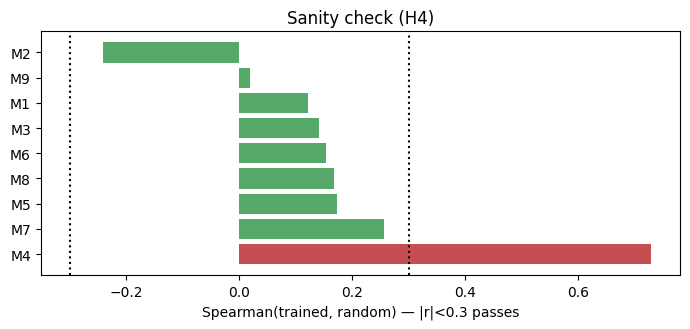

# Which explanations can we trust? A faithfulness audit of a frozen pediatric SFCN

-blue)
-success)

-9cf)

A pre-registered, public-data validation of **nine saliency/attribution methods** on a frozen
pretrained **SFCN** brain-age network. The question is not *where does the model look* but a
harder one that is almost never asked before a map is believed: **is the explanation faithful
to the model, consistent across methods, and anatomically valid under a corrected test?**

Follow-up to Das, Duarte, Lebel & Bento (2024), *Deep learning for detecting prenatal alcohol
exposure in pediatric brain MRI* (Front. Comput. Neurosci. 18:1434421). The public data are
**controls only**, so this project makes **no claim about alcohol exposure**; it uses an
age-group proxy (the signal the frozen brain-age features actually encode) to audit the
explanation methods on the exact backbone, on data anyone can download.

**Paper:** [`paper/trustworthy_xai_pediatric_sfcn.pdf`](paper/trustworthy_xai_pediatric_sfcn.pdf)
 · **Full results:** [`results/REPORT.md`](results/REPORT.md) · **Protocol:** [`docs/prenatal_xai_plan.md`](docs/prenatal_xai_plan.md)

---

*The same scan, nine methods. They disagree sharply on which regions matter — which is exactly
why a validation step is needed before any map is read anatomically.*

## Key results — the method verdict

| Question | Verdict |
|---|---|
| **Faithful?** (do the flagged voxels drive the output) | Occlusion-based **ReX is the most faithful** (deletion AUC **0.14**); early-block Grad-CAM the least (**0.78**) — a **5× spread** across methods. |
| **Model-driven, not input-driven?** | 8 of 9 pass a randomized-weight sanity check; **Integrated Gradients fails** (Spearman **r = 0.73** between trained and random model). |
| **Consistent across methods?** | Weak: mean pairwise region-level Spearman **0.36**; the two Grad-CAM variants are anti-correlated. |
| **Anatomically valid?** | 15 cortical regions survive FDR under an exploratory zero-fill (**post-hoc**); **none** under the pre-specified mean-intensity fill. |

The deliverable is the **method verdict and a reusable protocol**, not a diagnostic classifier.
The proxy head is intentionally modest (~64% CV accuracy) — accuracy is not the point.

  
  

*Left: deletion/insertion AUC — ReX (M9) is in its own band. Right: trained-vs-random
similarity — Integrated Gradients (M4) stays correlated even when the whole network is
reinitialized, so its map is input-driven.*

## What makes this a clean test

- **Pre-registered protocol** (OSF `jycnr`): six hypotheses and a decision log fixed before the run; post-hoc analyses are labelled as such.
- **One scan per child** (`n = 96`), child-grouped cross-validation — **no child-level leakage** from repeated/longitudinal scans.
- **Native-space design:** the frozen SFCN is kept in its pretraining space (UK Biobank/MNI152), so the transfer-learned features stay valid rather than being warped onto a pediatric template.
- **Nine methods, multiple criteria:** faithfulness, randomized-weight sanity, resolution, cross-method agreement, and a multiple-comparison-corrected region-masking test.
- **Fully public and reproducible:** public cohort, released code, pre-specified plan, and the complete per-region p-value log.

## Data

- **Source:** Calgary Preschool MRI Dataset, OSF project `axz5r`, **fork `5kz2p`** (CC-BY 4.0). `5kz2p` is the **dataset** fork (not the model). The original project storage is empty; the fork holds the usable scans.
- **Cohort:** 96 unique children, one T1 each (50 male, 46 female; age 3.84 ± 0.83 y, range 2.58–6.90). See `data/manifest.csv` and `results/table1_cohort.csv`.
- **Model weights (separate):** `weights/sfcn_brainage.p`, the UK Biobank brain-age SFCN from [github.com/ha-ha-ha-han/UKBiobank_deep_pretrain](https://github.com/ha-ha-ha-han/UKBiobank_deep_pretrain). Gitignored.
- The T1 sheet lists 279 scans, but these are repeat visits of the same 96 children; we take **one scan per child**, so the cohort is child-level, not scan-level.

## Repository layout

| Path | Contents |
|---|---|
| `paper/` | Manuscript (`.tex`, `.pdf`), figures, and `references.bib` |
| `docs/prenatal_xai_plan.md` | Pre-specified protocol and decision log |
| `notebooks/prenatal_xai_prep.ipynb` | Preprocessing: download, registration, frozen SFCN feature extraction |
| `notebooks/prenatal_xai_kaggle.ipynb` | Main analysis: classifier + nine attribution methods + metrics |
| `code/sfcn.py` | SFCN architecture + frozen feature-extractor loader |
| `code/run_all_methods.py` | Attribution methods M1–M9 |
| `code/rex_3d.py` | M9: 3D ReX occlusion-responsibility on the 5×6×5 grid |
| `code/eval_metrics.py` | Faithfulness, sanity check, bootstrap CIs, permutation, Benjamini–Hochberg |
| `code/fetch_osf_scans.py`, `fetch_extra_scans.py` | Two-pass cohort loader (handles the ID-hyphenation mismatch) |
| `results/` | REPORT, figures, cohort table, full per-region p-value log |

Not committed (`.gitignore`): `full_ds/`, `upload/`, `prep_output/`, `weights/`, archives.

## Reproducing

**Preprocessing**
1. `python code/fetch_osf_scans.py ./full_ds` — fetch the labelled scans
2. `python code/fetch_extra_scans.py` — second pass, recovers 11 children with different ID hyphenation (cohort → 96)
3. Run `notebooks/prenatal_xai_prep.ipynb` (Kaggle with all 96 scans attached, or locally in `./work`); check `preprocessed N/M | failures: K`
4. Copy `prep_output/` back into the project

**Analysis** — run `notebooks/prenatal_xai_kaggle.ipynb` with the preprocessed dataset attached.
Dependencies are installed by the notebook (`torch`, `nibabel`, `scikit-learn`, `scipy`,
`antspyx`, `antspynet`, `nilearn`, plus `captum` and `zennit` for the attribution methods).

## Citation

> Das A, Duarte K, Lebel C, Bento M (2024). Deep learning for detecting prenatal alcohol exposure in pediatric brain MRI. *Frontiers in Computational Neuroscience* 18:1434421. doi:10.3389/fncom.2024.1434421

Dataset: Calgary Preschool MRI Dataset, OSF project `axz5r` (fork `5kz2p`), CC-BY 4.0.

## License

Data: CC-BY 4.0 (OSF fork). Code: not yet chosen.
