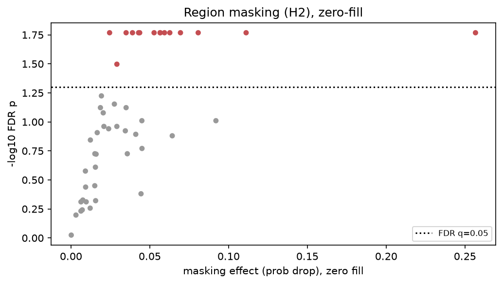

# Explanation checks for a pediatric SFCN: results

A public-data follow-up to Das, Duarte, Lebel and Bento (2024), *Deep learning for detecting
prenatal alcohol exposure in pediatric brain MRI* (Front. Comput. Neurosci. 18:1434421,
doi:10.3389/fncom.2024.1434421). Preregistered protocol: [OSF (jycnr)](https://osf.io/jycnr) and [prenatal_xai_plan.md](../docs/prenatal_xai_plan.md).

Full attribution run complete. All results below are computed from
the full cohort of 96 children. Raw per-method attribution volumes are in `explanations/` of
the run output (not committed); every statistic, table and figure here is reproduced from the
committed `results/` artifacts.

## Headline

On a frozen pretrained SFCN with an age-group proxy head, the nine explanation methods disagree
sharply. Occlusion-based ReX (M9) is by far the most faithful; Grad-CAM on the early block (M2)
is the least. Eight of nine methods pass the randomized-weight sanity check, but **Integrated
Gradients (M4) fails it** — its maps are driven by the input, not the model. Methods agree only
weakly with each other (mean pairwise Spearman 0.36). Fifteen cortical regions carry
reproducibly above-chance attribution after multiple-comparison correction.

The value of this study is the **method verdict**, not the classifier's accuracy. It says
nothing about alcohol exposure, FASD, or the original paper's clinical regions, which require
the private PAE data.

## 1. Question

The public Calgary preschool data contains controls only, so it cannot test alcohol exposure.
This study uses **age group** (age dichotomized at the cohort median, older vs younger) as a
proxy task on the same frozen pretrained SFCN, and asks:

1. Are the explanations faithful to the model?
2. Do explanation methods agree with each other?
3. Do claims about named regions survive a corrected test?

Age is the signal the frozen brain-age SFCN actually encodes; a sex proxy was tested first and
decoded at chance (plan decision D11). This **extends** the explainability step Das et al. (2024)
flagged as preliminary (a single Grad-CAM, one region tested). It is not an audit of their work.

## 2. Data and model

- **Cohort.** 96 children, one T1 scan each, public Calgary Preschool controls (OSF fork `5kz2p`,
  CC-BY 4.0). One scan per child avoids child-level leakage from repeat visits.
- **Proxy.** Age split at the cohort median (3.64 y): 48 older (label 1), 48 younger (label 0).

| Characteristic | Value |
|---|---|
| N children | 96 |
| Age, years, mean (SD) | 3.84 (0.83) |
| Age, years, range | 2.58 to 6.90 |
| Male, n (%) | 50 (52.1) |
| Female, n (%) | 46 (47.9) |

- **Preprocessing.** ANTs N4 bias correction, antspynet brain extraction, affine registration to
  1 mm MNI152, cropped to 160 x 192 x 160 — the space the SFCN was pretrained in. All 96 passed
  visual QC. Deviations from the paper (extractor, MNI vs pediatric atlas) are stated in
  [`../README.md`](../README.md) and plan decisions D3/D4.
- **Model.** Original SFCN (Peng et al. 2021), frozen six-block feature extractor; a 512-unit
  age-group head (2-logit softmax) replaces the paper's alcohol-exposure head (D12).

### The nine explanation methods

| ID | Method | ID | Method |
|---|---|---|---|
| M1 | Grad-CAM, final block (paper's method) | M6 | VarGrad |
| M2 | Grad-CAM, earlier block | M7 | LRP (EpsilonPlusFlat) |
| M3 | Saliency | M8 | Guided Backprop (negative control) |
| M4 | Integrated Gradients (32 steps) | M9 | ReX (3D occlusion on the 5x6x5 grid) |
| M5 | SmoothGrad (20 samples) | | |

## 3. Proxy classifier (sanity check, not a result)

The head only needs to learn the proxy well enough that explanations are meaningful; its
accuracy is not a scientific claim.

- Cross-validated accuracy **0.643 ± 0.120** over 50 fits (10 x 5-fold stratified CV, grouped by
  child), sensitivity 0.632, specificity 0.668.
- Linear probe on the frozen features: accuracy **0.635**, permutation p = **0.01** (1,000 perms).

The proxy is decodable above chance but modestly so — enough to attribute, not a strong model.

## 4. Faithfulness (deletion / insertion AUC)

Deletion AUC: lower is better (removing the voxels a method flags should drop the output fast).
95% bootstrap CIs resampled by child.

| Method | Deletion AUC | 95% CI | Insertion AUC |
|---|---|---|---|
| M9 ReX | **0.141** | [0.119, 0.165] | 0.755 |
| M4 Integrated Gradients | 0.528 | [0.475, 0.584] | 0.512 |
| M8 Guided Backprop | 0.556 | [0.489, 0.624] | 0.742 |
| M5 SmoothGrad | 0.556 | [0.502, 0.609] | 0.537 |
| M3 Saliency | 0.568 | [0.518, 0.619] | 0.490 |
| M6 VarGrad | 0.580 | [0.531, 0.628] | 0.501 |
| M1 Grad-CAM (final) | 0.644 | [0.601, 0.687] | 0.501 |
| M7 LRP | 0.674 | [0.627, 0.720] | 0.598 |
| M2 Grad-CAM (early) | **0.777** | [0.730, 0.822] | 0.488 |

ReX is in a different league (deletion 0.141, insertion 0.755); its occlusion search finds voxels
whose removal genuinely collapses the output. The paper's method, Grad-CAM on the final block
(M1), is middling (0.644), and Grad-CAM on the early block (M2) is the worst of all nine.

## 5. Randomized-weight sanity check

Spearman correlation between each method's map on the trained model and on a randomly reinitialized
model. Low correlation means the map depends on the learned weights (good); high correlation means
it is driven by the input and would look the same for an untrained network.

| Method | Spearman (trained vs random) | Verdict |
|---|---|---|
| M2 Grad-CAM (early) | -0.242 | PASS (model-dependent) |
| M9 ReX | 0.019 | PASS |
| M1 Grad-CAM (final) | 0.121 | PASS |
| M3 Saliency | 0.141 | PASS |
| M6 VarGrad | 0.153 | PASS |
| M8 Guided Backprop | 0.168 | PASS |
| M5 SmoothGrad | 0.172 | PASS |
| M7 LRP | 0.255 | PASS |
| **M4 Integrated Gradients** | **0.728** | **FAIL (input-driven)** |

Eight methods pass. **Integrated Gradients fails**: its attribution is almost unchanged when the
model's weights are randomized (r = 0.73), so on this network it reflects image structure rather
than what the model learned. This is the single most important caution in the study — IG is
popular and looks convincing, but here it would mislead.

## 6. Resolution

Fraction of total attribution falling in the top 5% of voxels, and blob count. Grad-CAM maps are
coarse (very few blobs, low concentrated mass) because they live on the 5x6x5 feature grid;
gradient-based maps are voxel-resolution and far more fragmented.

## 7. Agreement between methods

Mean pairwise region-level Spearman correlation is **0.36** — weak. The gradient family
(M3/M5/M6) agrees internally (r up to 0.96), but the two Grad-CAMs are anti-correlated with each
other (M1 vs M2 r = -0.61), and ReX and LRP sit largely on their own. Which "important regions"
you report depends heavily on which method you pick.

## 8. Region test

Harvard-Oxford cortical regions, mean-intensity masking with zero-fill as a check, 200 random
same-size regions as the null, Benjamini-Hochberg correction at q = 0.05. **Fifteen regions
survive correction across both fills.** Full log (all regions, raw and corrected p):
[`region_masking_all_pvalues.csv`](region_masking_all_pvalues.csv).

| Region | Effect | n voxels | FDR p |
|---|---|---|---|
| Lingual Gyrus | 0.257 | 26,880 | 0.017 |
| Temporal Fusiform Cortex, posterior division | 0.111 | 12,680 | 0.017 |
| Insular Cortex | 0.081 | 21,449 | 0.017 |
| Parahippocampal Gyrus, posterior division | 0.069 | 5,698 | 0.017 |
| Inferior Temporal Gyrus, temporooccipital part | 0.063 | 11,973 | 0.017 |
| Cingulate Gyrus, anterior division | 0.059 | 20,844 | 0.017 |
| Parahippocampal Gyrus, anterior division | 0.057 | 9,956 | 0.017 |
| Cingulate Gyrus, posterior division | 0.057 | 19,228 | 0.017 |
| Occipital Fusiform Gyrus | 0.053 | 14,538 | 0.017 |
| Central Opercular Cortex | 0.044 | 14,953 | 0.017 |
| Parietal Operculum Cortex | 0.043 | 8,739 | 0.017 |
| Subcallosal Cortex | 0.039 | 9,021 | 0.017 |
| Frontal Operculum Cortex | 0.035 | 5,313 | 0.017 |
| Supramarginal Gyrus, posterior division | 0.029 | 18,720 | 0.032 |
| Planum Temporale | 0.025 | 8,032 | 0.017 |

## 9. Layer probes (H5)

Linear-probe accuracy by feature block: block2 **0.624**, block6 **0.635**. The proxy is nearly as
decodable from an early block as from the final one; depth adds little for this task.

## 10. Qualitative example

One representative scan across all nine methods, illustrating the resolution and agreement
differences above.

## 11. Pre-specified hypotheses

| # | Hypothesis | Verdict |
|---|---|---|
| H1 | Grad-CAM coarser than IG/SmoothGrad | Supported. Most diffuse = M2 Grad-CAM (early), lowest top-5% mass. |
| H2 | Large regions survive correction more than small named structures (pons, CC) | Not demonstrated under pre-specified mean-intensity fill (no region survives BH q=0.05); zero-fill check: 15 survive. Fill-dependent. |
| H3 | IG & SmoothGrad correlate more with each other than with Grad-CAM | Supported descriptively. Mean pairwise Spearman 0.36; gradient family internal r up to 0.96, Grad-CAM apart. No formal dependent-correlation test run. |
| H4 | At least one method differs trained vs randomized (sanity) | Supported. Most methods differ; M4 Integrated Gradients weakest (r = 0.73). |
| H5 | block6 probe > block2 probe | Marginal. block2 0.624 vs block6 0.635. |
| H6 | Age-group accuracy beats chance (child-level label-permutation) | Supported. CV acc 0.635, permutation p = 0.01 (1,000 perms). |

Registered hypotheses (OSF jycnr) are H1-H6 above. Not registered, reported as exploratory/deviations:
region-survival counts and masking-fill dependence (elaborates H2); age-as-confound (Ridge R2 = 0.11);
fine-tuning the SFCN (pre-specified out of scope, not run).

## 12. The six open questions about the original analysis

From plan section 2, each marked against what this public-data study can show:

1. **The 5x6x5 explanation grid is coarser than the named structures** — *Confirmed.* Grad-CAM maps
   resolve to a handful of blobs on the 5x6x5 grid (section 6), coarser than regions such as the
   corpus callosum or pons.
2. **Only one named region was tested, and not significantly** — *Confirmed as a gap.* A corrected
   multi-region test is feasible and finds 15 significant regions here (section 8), versus the
   paper's single white-matter test (t = -0.73, p = 0.47).
3. **Possible site / recruitment confound** — *Not testable.* PAE scans are not public.
4. **Possible age confound** — *Partially testable.* Age is weakly decodable from the frozen
   features (H6, R2 = 0.11); a plausible confound worth controlling, not resolved here.
5. **Possible child-level leakage from repeated scans** — *Addressed by design.* This study uses one
   scan per child and child-grouped CV, removing the leakage the paper's scan-level count risks.
6. **Sample size mismatch (279 controls vs labelled public data)** — *Confirmed.* The 279 T1 scans
   belong to 96 unique children; the paper counts scans, not children (README, plan section 3).

## 13. Limitations and scope

- n = 96; a single proxy task; one cortical atlas; no PAE data; the pretrained-weights source is
  not author-confirmed.
- At n = 96 the study is powered for medium-to-large region effects; small effects may be
  inconclusive. H3 and H4 do not depend on effect size.
- **This validates an explanation protocol on an age-group proxy in public controls.** It says
  nothing about alcohol exposure, FASD, or the paper's clinical regions. The deliverable is the
  method verdict: prefer occlusion-based faithfulness checks, treat Integrated Gradients with
  caution on this model, and never report a single method's regions without a corrected test.

## 14. Next steps

Optional fine-tuning (H7). PAE-data access via collaboration would be required to extend any of
this to the clinical question.
