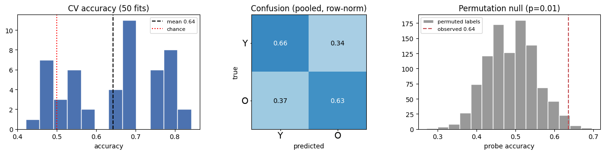
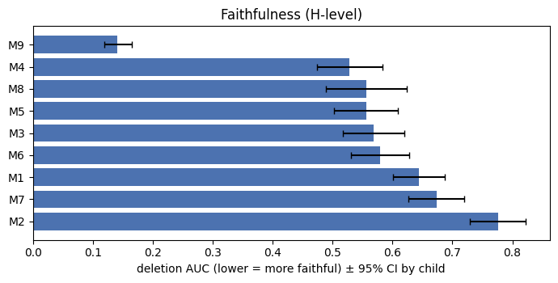
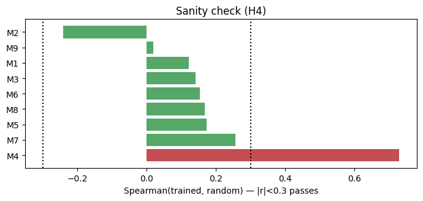
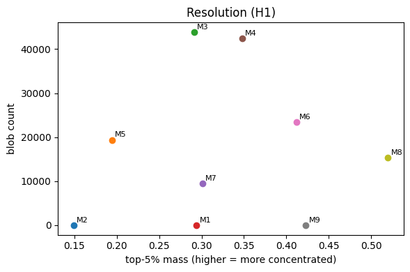
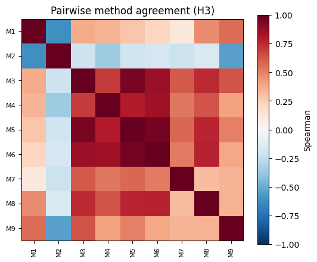
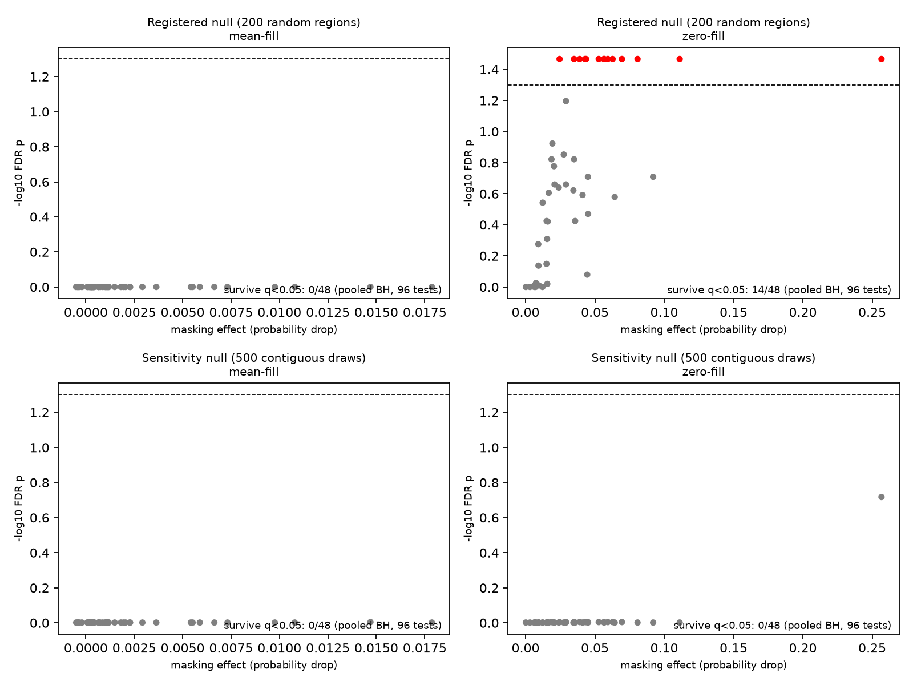
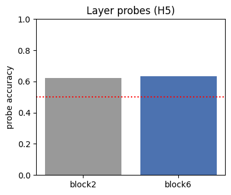
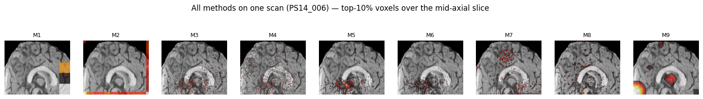

# Explanation checks for a pediatric SFCN: results

A public-data follow-up to Das, Duarte, Lebel and Bento (2024), *Deep learning for detecting
prenatal alcohol exposure in pediatric brain MRI* (Front. Comput. Neurosci. 18:1434421,
doi:10.3389/fncom.2024.1434421). Preregistered protocol: [OSF (jycnr)](https://osf.io/jycnr) and
[prenatal_xai_plan.md](../docs/prenatal_xai_plan.md) (post-run changes are listed in its section 9).

All results below are computed from the full cohort of 96 children. Raw per-method attribution
volumes are in `explanations/` of the Kaggle run output (not committed). Every statistic, table and
figure here is reproduced from the committed `results/` and `results_revised_null/` artifacts.

**Region test, two analyses.** The pre-registered region test (200 random same-size regions) is the
primary analysis. Under the mean-intensity fill no region survives correction. The zero-fill check, also
pre-registered, flags 14 regions, all at the null's p-value floor. After the first run we added a post-hoc
sensitivity analysis (500 contiguous translated regions, merged over both Kaggle halves). It finds no region
under either fill, so the zero-fill result is not robust to the null model.

## Headline

On a frozen pretrained SFCN with an age-group proxy head, the nine explanation methods disagree
sharply. Occlusion-based ReX (M9) is by far the most faithful, and Grad-CAM on the early block (M2)
is the least. Eight of nine methods pass the randomized-weight sanity check, but **Integrated
Gradients (M4) fails it**: its maps are driven by the input, not the model. Methods agree only
weakly with each other (mean pairwise Spearman 0.36). **Under the pre-registered mean-intensity test no
cortical region survives correction.** The zero-fill check flags 14 regions under the registered null, but
none under the post-hoc sensitivity null. Method-to-masking agreement is weak for every method.

The value of this study is the **method verdict**, not the classifier's accuracy. It says nothing
about alcohol exposure, FASD, or the original paper's clinical regions, which require the private
PAE data.

## 1. Question

The public Calgary preschool data contains controls only, so it cannot test alcohol exposure.
This study uses **age group** (age dichotomized at the cohort median, older vs younger) as a proxy
task on the same frozen pretrained SFCN, and asks:

1. Are the explanations faithful to the model?
2. Do explanation methods agree with each other?
3. Do claims about named regions survive a corrected test?

Age is the signal the frozen brain-age SFCN actually encodes; a sex proxy was tested first and
decoded at chance (plan decision D11). This **extends** the explainability step Das et al. (2024)
flagged as preliminary (a single Grad-CAM, one region tested). It does not re-examine their work.

## 2. Data and model

- **Cohort.** 96 children, one T1 scan each, public Calgary Preschool controls (OSF fork `5kz2p`,
  CC-BY 4.0). One scan per child avoids child-level leakage from repeat visits.
- **Proxy.** Age split at the cohort median (3.64 y): 48 older (label 1), 48 younger (label 0).

| Characteristic | Value |
|---|---|
| N children | 96 |
| Age, years, mean (SD) | 3.84 (0.83) |
| Age, years, range | 2.58 to 6.90 |
| Male, n (%) | 50 (52.1) |
| Female, n (%) | 46 (47.9) |

- **Preprocessing.** ANTs N4 bias correction, antspynet brain extraction, affine registration to
  1 mm MNI152, cropped to 160 x 192 x 160, the space the SFCN was pretrained in. All 96 passed visual
  QC. Deviations from the paper (extractor, MNI vs pediatric atlas) are stated in
  [`../README.md`](../README.md) and plan decisions D3/D4.
- **Model.** Original SFCN (Peng et al. 2021), frozen six-block feature extractor. A 512-unit
  age-group head (2-logit softmax) replaces the paper's alcohol-exposure head (D12).

### The nine explanation methods

| ID | Method | ID | Method |
|---|---|---|---|
| M1 | Grad-CAM, final block (paper's method) | M6 | VarGrad |
| M2 | Grad-CAM, earlier block | M7 | LRP (EpsilonPlusFlat) |
| M3 | Saliency | M8 | Guided Backprop (negative control) |
| M4 | Integrated Gradients (32 steps) | M9 | ReX (3D occlusion on the 5x6x5 grid) |
| M5 | SmoothGrad (20 samples) | | |

## 3. Proxy classifier (sanity check, not a result)

The head only needs to learn the proxy well enough that explanations are meaningful; its accuracy is
not a scientific claim.

- Cross-validated accuracy **0.643 ± 0.120** over 50 fits (10 x 5-fold stratified CV, grouped by
  child), sensitivity 0.632, specificity 0.668.
- Linear probe on the frozen features: accuracy **0.635**, permutation p = **0.01** (1,000 perms).
  This permutation test comes from the original run; the masking runs set N_PERM_ACC = 0 and skipped it.

The proxy is decodable above chance but modestly so: enough to attribute, not a strong model.

## 4. Faithfulness (deletion / insertion AUC)

Deletion AUC: lower is better (removing the voxels a method flags should drop the output fast).
Insertion AUC: higher is better. 95% bootstrap CIs are resampled by child (10,000 resamples). The
insertion CIs and the random-order baseline come from the academic-account re-run of the faithfulness
stage; its insertion values differ from the first run by at most 0.001.

| Method | Deletion AUC | 95% CI | Insertion AUC | 95% CI |
|---|---|---|---|---|
| M9 ReX | **0.141** | [0.119, 0.165] | 0.755 | [0.713, 0.793] |
| M4 Integrated Gradients | 0.528 | [0.475, 0.584] | 0.513 | [0.479, 0.548] |
| M8 Guided Backprop | 0.556 | [0.489, 0.624] | 0.742 | [0.701, 0.780] |
| M5 SmoothGrad | 0.556 | [0.502, 0.609] | 0.538 | [0.486, 0.589] |
| M3 Saliency | 0.568 | [0.518, 0.619] | 0.490 | [0.438, 0.543] |
| M6 VarGrad | 0.580 | [0.531, 0.628] | 0.501 | [0.440, 0.560] |
| M1 Grad-CAM (final) | 0.644 | [0.601, 0.687] | 0.501 | [0.471, 0.532] |
| M7 LRP | 0.674 | [0.627, 0.720] | 0.598 | [0.529, 0.665] |
| M2 Grad-CAM (early) | **0.777** | [0.730, 0.822] | 0.488 | [0.477, 0.499] |
| *Random order (baseline)* | 0.592 (SD 0.189) | | 0.429 (SD 0.311) | |

- **Under zero fill, ReX has the lowest deletion AUC. This ranking does not hold under in-distribution fills (see the three-fill table below)**, and its occlusion search finds voxels whose
  removal collapses the output. This advantage is partly by construction, because ReX searches for
  regions whose removal changes the prediction, which is what deletion measures.
- **On insertion, ReX and Guided Backprop are indistinguishable.** The paired difference is 0.014,
  95% bootstrap CI [-0.047, 0.072], two-sided bootstrap p = 0.65 (96 children).
- **Random-order baseline.** Against random voxel ordering (deletion 0.592, insertion 0.429), early
  Grad-CAM (M2, 0.777) and LRP (M7, 0.674) are worse on deletion, and final Grad-CAM (M1, 0.644) is
  borderline. The insertion gaps between most methods and the baseline are small relative to its SD.
- The five mid-ranked methods (IG, Guided Backprop, SmoothGrad, Saliency, VarGrad) have overlapping
  CIs and should be read as a tie.

### Three-fill check (added after the first run)

Under mean-intensity fill ReX has the highest deletion AUC (0.877) and the lowest insertion AUC (0.295). Under blur fill
Guided Backprop leads (deletion 0.753, insertion 0.882). Rankings depend on the fill, so no method is claimed to be the
most faithful. Full table with CIs: `results_revised_null/faithfulness_ci_by_fill.csv`.

## 5. Randomized-weight sanity check

Spearman correlation between each method's map on the trained model and on a randomly reinitialized
model. Low correlation means the map depends on the learned weights (good); high correlation means it
is driven by the input and would look the same for an untrained network.

| Method | Spearman (trained vs random) | Verdict |
|---|---|---|
| M2 Grad-CAM (early) | -0.242 | PASS |
| M9 ReX | 0.019 | PASS |
| M1 Grad-CAM (final) | 0.121 | PASS |
| M3 Saliency | 0.141 | PASS |
| M6 VarGrad | 0.153 | PASS |
| M8 Guided Backprop | 0.168 | PASS |
| M5 SmoothGrad | 0.172 | PASS |
| M7 LRP | 0.255 | PASS |
| **M4 Integrated Gradients** | **0.728** | **FAIL (input-driven)** |

Eight methods pass (|r| < 0.3, a pre-specified heuristic). **Integrated Gradients fails**: its
attribution is almost unchanged when the model's weights are randomized (r = 0.73), so on this
network it reflects image structure rather than what the model learned. This is the most important
caution in the study. IG is popular and looks convincing, but here it would mislead. The check is a
single random draw with complete randomization. The cascading variant of Adebayo et al. (2018) was not run.

## 6. Resolution

Fraction of total attribution falling in the top 5% of voxels, and blob count. Blob count is the number
of 6-connected components among voxels at or above the map's 95th percentile of absolute attribution.
It measures fragmentation, not blob size.

- Final-block Grad-CAM (M1) gives about 3 blobs and ReX (M9) about 4, both on the 5x6x5 grid.
- Early-block Grad-CAM (M2) gives about 13.
- SmoothGrad gives about 19,000 and Integrated Gradients about 42,000 (voxel-resolution, fragmented).

## 7. Agreement between methods

Mean pairwise region-level Spearman correlation over the 36 method pairs is **0.36**, which is weak.
The gradient family (M3/M5/M6) agrees internally (r up to 0.96). The two Grad-CAMs are anti-correlated
(M1 vs M2 r = -0.61). ReX correlates most with final Grad-CAM (r = 0.56) and is anti-correlated with
early Grad-CAM (r = -0.54). Which "important regions" you report depends heavily on which method you pick.

## 8. Region test

Harvard-Oxford cortical regions (48), each tested by masking the region and recording the drop in
predicted-class probability. Two-sided p-values, Benjamini-Hochberg at q = 0.05 applied across all 96 region-by-fill tests
(48 regions under each fill). Both Kaggle halves (REGION_HALF = 0 and 1) were merged before correction.

**Registered analysis (primary).** Null: 200 random same-size regions (smallest attainable p about 0.005).
Mean-intensity fill: **no region survives** (smallest raw p = 0.945). Zero fill (registered as a check): **14
regions survive**, all at the p floor, so the correction cannot rank them. Full log:
[`region_masking_all_pvalues.csv`](region_masking_all_pvalues.csv) (in `kaggle_output_prenatal_xai_96/results/`).

| Region (zero fill, registered null) | Effect | n voxels | Raw p | FDR p |
|---|---|---|---|---|
| Lingual Gyrus | 0.257 | 26,880 | 0.005 | 0.034 |
| Temporal Fusiform Cortex, posterior division | 0.111 | 12,680 | 0.005 | 0.034 |
| Insular Cortex | 0.081 | 21,449 | 0.005 | 0.034 |
| Parahippocampal Gyrus, posterior division | 0.069 | 5,698 | 0.005 | 0.034 |
| Inferior Temporal Gyrus, temporooccipital part | 0.063 | 11,973 | 0.005 | 0.034 |
| Cingulate Gyrus, anterior division | 0.059 | 20,844 | 0.005 | 0.034 |
| Parahippocampal Gyrus, anterior division | 0.057 | 9,956 | 0.005 | 0.034 |
| Cingulate Gyrus, posterior division | 0.057 | 19,228 | 0.005 | 0.034 |
| Occipital Fusiform Gyrus | 0.053 | 14,538 | 0.005 | 0.034 |
| Central Opercular Cortex | 0.044 | 14,953 | 0.005 | 0.034 |
| Parietal Operculum Cortex | 0.043 | 8,739 | 0.005 | 0.034 |
| Subcallosal Cortex | 0.039 | 9,021 | 0.005 | 0.034 |
| Frontal Operculum Cortex | 0.035 | 5,313 | 0.005 | 0.034 |
| Planum Temporale | 0.025 | 8,032 | 0.005 | 0.034 |

All fourteen are also in Appendix B of the paper.

**Sensitivity analysis (post-hoc).** Null: 500 same-size regions drawn as contiguous translations of the real mask
inside gray matter (smallest attainable p about 0.002). Added after the first run, because every mean-fill p-value
under the registered null sat near 1 and the scattered null is poorly matched to region shape. **No region survives
under either fill.** Zero fill: smallest FDR p = 0.192 (Lingual Gyrus, raw p = 0.002). Mean fill: smallest raw p = 0.186.
Full log: [`../results_revised_null/region_masking_merged.csv`](../results_revised_null/region_masking_merged.csv).

**Interpretation.** The zero-fill result depends on the null model, and zero blanking is out of distribution.
No region-level claim is robust.

**Method-to-masking agreement.** For each method, Spearman correlation between its mean absolute attribution per
region (48) and the zero-fill masking effect, with a permutation p-value from 10,000 shuffles. The masking effects are
identical under both nulls, so these correlations do not depend on the null
([`../results_revised_null/method_vs_masking_correlation_merged.csv`](../results_revised_null/method_vs_masking_correlation_merged.csv)):

| Method | Spearman | Perm. p |
|---|---|---|
| M1 Grad-CAM (final) | +0.189 | 0.20 |
| M2 Grad-CAM (early) | -0.036 | 0.81 |
| M3 Saliency | +0.089 | 0.55 |
| M4 Integrated Gradients | +0.121 | 0.41 |
| M5 SmoothGrad | -0.007 | 0.96 |
| M6 VarGrad | +0.022 | 0.89 |
| M7 LRP | +0.159 | 0.29 |
| M8 Guided Backprop | +0.040 | 0.79 |
| M9 ReX | +0.175 | 0.24 |

No method's region ranking tracks the model's masking dependence. The 48 regions are spatially autocorrelated, so these
p-values are optimistic.

## 9. Layer probes (H5)

Linear-probe accuracy by feature block: block2 **0.624**, block6 **0.635**. The proxy is nearly as
decodable from an early block as from the final one, so depth adds little for this task.

## 10. Qualitative example

One representative scan across all nine methods, illustrating the resolution and agreement differences above.

## 11. Pre-specified hypotheses

| # | Hypothesis | Verdict |
|---|---|---|
| H1 | Grad-CAM coarser than IG/SmoothGrad | Supported on blob count (M1 about 3, M2 about 13, SmoothGrad about 19,000, IG about 42,000). Top-5% mass does not discriminate cleanly, so the claim rests on blob count. |
| H2 | Large regions survive correction more than small named structures (pons, CC) | Not testable with a confirmatory result: no region survives BH q = 0.05 under the registered mean-fill test; the 14 zero-fill survivors of the registered null do not survive the sensitivity null. |
| H3 | IG & SmoothGrad correlate more with each other than with Grad-CAM | Supported descriptively. IG-SmoothGrad r = 0.80, IG-M1 r = 0.34, SmoothGrad-M1 r = 0.28. No formal dependent-correlation test run. |
| H4 | At least one method differs trained vs randomized (sanity) | Supported. Most methods differ; M4 Integrated Gradients weakest (r = 0.73). |
| H5 | block6 probe > block2 probe | Not supported. block2 0.624 vs block6 0.635, within the CV SD (0.12). |
| H6 | Age-group accuracy beats chance (child-level label-permutation) | Supported. Probe accuracy 0.635, permutation p = 0.01 (1,000 perms, original run). |

Registered hypotheses (OSF jycnr) are H1-H6 above. Not registered, reported as exploratory deviations
(plan section 9): the null-model revision and its effect on region survival (elaborates H2); the
random-order baseline; the method-to-masking correlation analysis; age-as-confound (Ridge R2 = 0.11);
fine-tuning the SFCN (pre-specified out of scope, not run).

## 12. The five open questions about the original analysis

From plan section 2, each marked against what this public-data study can show:

1. **The 5x6x5 explanation grid is coarser than the named structures.** *Confirmed.* Grad-CAM maps
   resolve to a handful of blobs on the 5x6x5 grid (section 6), coarser than regions such as the corpus
   callosum or pons.
2. **Only one named region was tested, and not significantly.** *Run.* A multi-region test with FDR control was run. Under the registered null, 14 regions pass under zero
   fill (exploratory) and none under mean fill. Under the post-hoc sensitivity null, none passes. The paper's single white-matter test (t = -0.73, p = 0.47) is a different
   test, so no direct comparison of effects is drawn.
3. **Possible site / recruitment confound.** *Not testable.* PAE scans are not public.
4. **Possible age confound.** *Partially testable.* Age is weakly decodable from the frozen features
   (H6, R2 = 0.11). A plausible confound worth controlling, not resolved here.
5. **Possible child-level leakage from repeated scans.** *Addressed by design.* This study uses one scan
   per child and child-grouped CV. The public T1 sheet lists 279 scans for these 96 children (repeat visits),
   which is why the analysis is at the child level (README, plan section 3).

## 13. Limitations and scope

- n = 96; a single proxy task; one cortical atlas; no PAE data; the pretrained-weights source is not
  author-confirmed.
- The registered region test (200 random regions) has a p floor of about 0.005, so its 14 zero-fill survivors
  cannot be ranked. The sensitivity null (500 contiguous draws, added after the first run; plan section 9, A1)
  has a floor of about 0.002 and finds none.
- The random-order baseline is a random voxel ordering, which is a weaker null than a sparsity-matched
  random map.
- Method-to-masking correlations use the same 48 regions and inherit their spatial autocorrelation.
- At n = 96 the study is powered for medium-to-large region effects; small effects may be inconclusive.
  H3 and H4 do not depend on effect size.
- **This validates an explanation protocol on an age-group proxy in public controls.** It says nothing
  about alcohol exposure, FASD, or the paper's clinical regions. The deliverable is the method verdict:
  prefer occlusion-based faithfulness checks, treat Integrated Gradients with caution on this model, and
  never report a single method's regions without a corrected test.

## 14. Next steps

Optional fine-tuning (H7). PAE-data access via collaboration would be required to extend any of this to
the clinical question. A larger region null (N_NULL = 1,000) would need split Kaggle runs, because one
kernel is capped at 12 hours.
