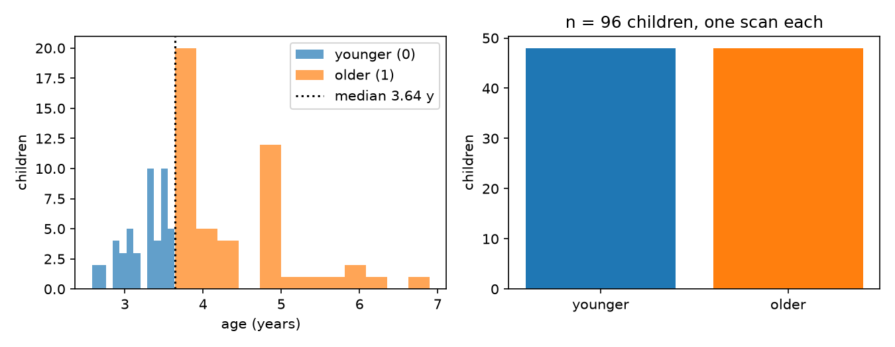
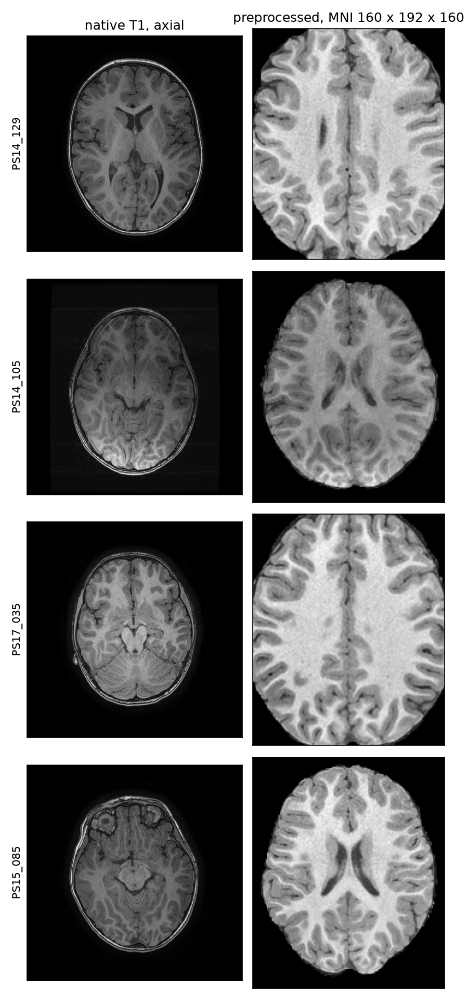
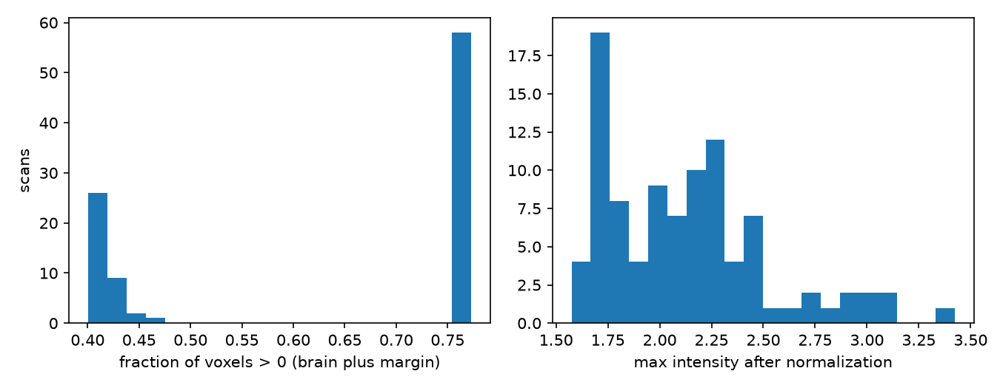
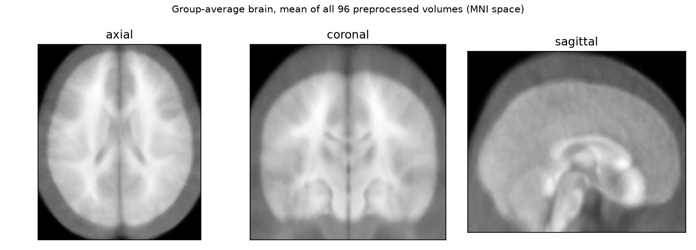
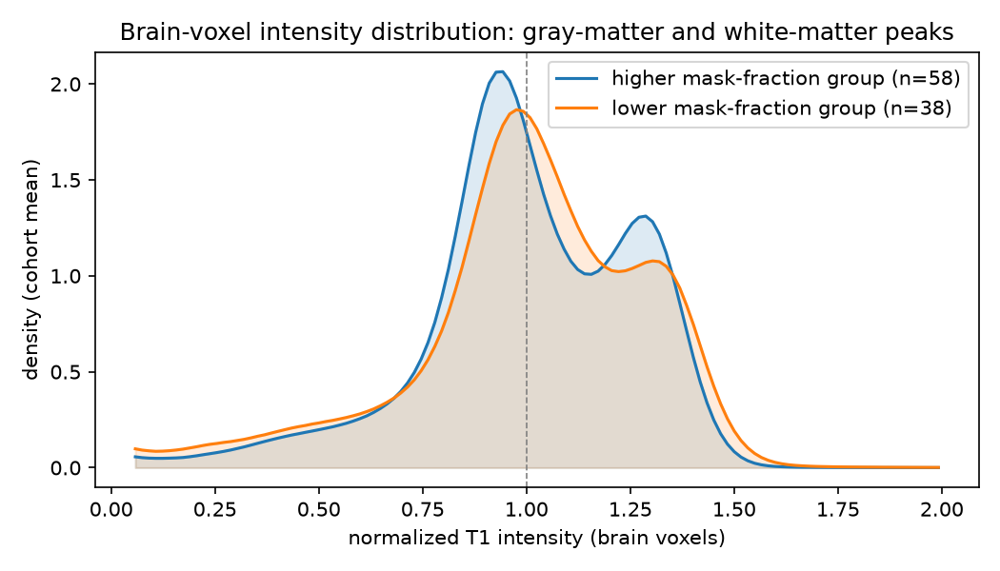
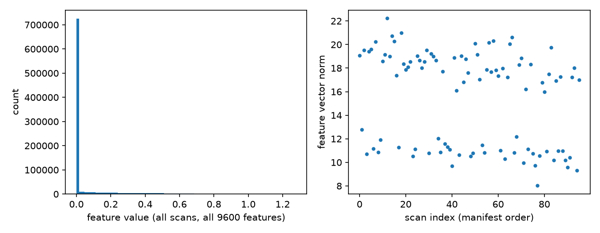

# Preprocessing report

## Data

96 children, one T1 scan each, from the public Calgary preschool dataset (OSF fork 5kz2p). 50 male, 46 female. Age 3.84 years (SD 0.83, range 2.58 to 6.90).

Native scans: 512 x 512 in-plane matrix, 0.449 x 0.449 mm in-plane voxels, 0.9 mm slices. 95 scans have 210 slices and one has 186. All are in LAS orientation.

## Steps

Each scan goes through the same steps in `prenatal_xai_prep.ipynb`, section 2.

1. **Bias correction (ANTs N4).** Removes the slow intensity gradient across the image caused by the coil.
2. **Brain extraction (antspynet).** A deep-learning model estimates the probability that each voxel is brain. Voxels with probability below 0.5 are set to zero. This removes skull, scalp and neck.
3. **Affine registration to MNI152 (1 mm).** Aligns the brain to a standard adult template, so every scan sits in the same space. Only translation, rotation, scaling and shearing are applied, so the shape of the brain is preserved.
4. **Crop or pad to 160 x 192 x 160.** This is the input size the pretrained SFCN expects.
5. **Normalization.** Each volume is divided by the mean of its non-zero voxels, so the typical brain intensity is 1.

The output is a float32 array per scan. The frozen SFCN then produces one feature vector of 64 x 5 x 6 x 5 = 9600 values per scan.

The left column shows the native T1 at the axial mid-slice. The right column shows the same scan after steps 1 to 5.

## Quality checks

- All 96 mid-sagittal slices were checked by eye and passed visual QC. Every scan in the cohort is in the analysis.
- All 96 volumes are finite and 160 x 192 x 160.
- The age and sex in `data/manifest.csv` match the spreadsheet for all 96 scans.

The fraction of voxels inside the brain mask is bimodal: 38 scans sit near 0.41 and 58 near 0.76. The cause of the bimodality is not known. A low mask fraction does not by itself indicate a problem.

## Cohort-level checks

The mean of all 96 preprocessed volumes in MNI space. Because every scan is registered to the same template, a consistent registration produces a sharp average with recognizable anatomy (ventricles, corpus callosum, brainstem, cerebellum); a misaligned cohort would average to a blur. The structures are clear, so registration is consistent across the cohort. Note this is an affine fit of preschool brains to an adult template, so some softness is expected.

Intensity distribution of brain voxels, averaged over the cohort and split by the two mask-fraction groups. The two humps are gray matter (near 0.95) and white matter (near 1.3). Both groups show the same two-peak shape, so tissue contrast is consistent and the mask-fraction split is not a difference in intensity calibration. This is an intensity distribution, not a volumetric segmentation.

## Open items

- Bimodal brain fraction: check the registration of a few scans from each group.
- Figures showing each intermediate step (bias-corrected, brain mask, registered) need one run that saves intermediates.

## Feature vectors

Feature values from the frozen SFCN for all 96 scans, and the vector norm per scan.

## Regenerating the figures

`python code/make_prep_figures.py` reads `data/manifest.csv` and the local `prep_output/` folder, and writes the PNGs to `results/figures/`. It runs in the project venv (`/home/houssem/.venvs/calgary`).
